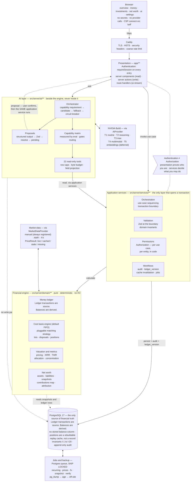

# Architecture

## 1. Product architecture

A private, single-user financial command centre. Six top-level areas, each with one job.

```
Overview     one screen answer to "where do I stand right now"
Money        accounts, transactions, categories, budgets, recurring commitments
Investments  instruments, investment ledger, holdings, portfolio performance, allocation
Net Worth    assets, liabilities, net worth now and over time, and why it changed
AI           conversational analysis and natural-language entry
Settings     currency, categories, market-data providers, security, export, backup
```

**Product invariants** (these are what make it a command centre rather than a spreadsheet):

1. Every number on screen traces to records the user can open. No figure appears without a path to its inputs.
2. Transfers move money; they never appear as income or expense anywhere in the product.
3. Holdings and portfolio values are computed from the investment ledger, never typed in.
4. A price that is stale, missing, or manually entered is labelled as such at the point of display.
5. The AI never changes data. It proposes; the user confirms; application code writes.

**Explicitly out of scope** (do not build without an explicit request): brokerage execution, automated trading, bank sync, automatic statement import, tax filing, robo-advisory, multi-user, social, native mobile, derivatives/options engines.

## 2. Layering

### System architecture diagram



Two load-bearing properties are drawn here rather than merely written down:

1. **The AI layer has no path to the database.** Write-shaped model output leaves the AI layer as a proposal, travels *up* to the user for confirmation, and is then executed by the same application service a manual form submission calls. See [ADR-08](DECISIONS.md#adr-08--ai-proposes-application-code-mutates) and [AI-SYSTEM.md §9](AI-SYSTEM.md#9-the-mutation-boundary).
2. **Application services are the only layer that opens a transaction.** The engine cannot write even by accident, because it has no database handle at all.

### Layer rules

Four layers, enforced by directory boundaries and lint rules.

Three statements govern the boundaries between them, and each is enforced somewhere rather than merely believed:

> **Authentication ≠ Authorization.** Presentation proves who you are. Application services decide what you may do, to which entity. ([SECURITY.md §0](SECURITY.md#0-authentication--authorization))
>
> **Ledger transactions are source. Balances are derived.** There is no stored balance column; positions are a rebuildable replay cache, not a record. ([FINANCIAL-DOMAIN.md §3](FINANCIAL-DOMAIN.md#3-accounts))
>
> **Cost basis engine (default FIFO).** The matching strategy is a parameter, not an assumption. ([INVESTMENT-DOMAIN.md §4](INVESTMENT-DOMAIN.md#4-cost-basis-engine-default-fifo))

```
┌───────────────────────────────────────────────────────────────┐
│  Presentation        app/**                                    │
│                      RSC, forms, server actions, route         │
│                      handlers. AUTHENTICATION lives here        │
│                      (requireSession). No business rules.       │
├───────────────────────────────────────────────────────────────┤
│  Application         src/server/services/**                    │
│  Services            Orchestration · validation · permissions   │
│                      · workflows. AUTHORIZATION lives here.     │
│                      The ONLY layer that opens a transaction    │
│                      or mutates. Owns no arithmetic.            │
├───────────────────────────────────────────────────────────────┤
│  Financial Engine    src/server/domain/**                      │
│                      Pure, deterministic, no I/O, no clock,     │
│                      no database handle. Owns every             │
│                      calculation and every invariant check.     │
│                      Cannot mutate — it has nothing to mutate   │
│                      with.                                      │
├───────────────────────────────────────────────────────────────┤
│  Financial Truth     src/server/db/**  — Postgres via Drizzle   │
│                      Schema, migrations, repositories.          │
└───────────────────────────────────────────────────────────────┘

        AI Intelligence  src/server/ai/**   — sits BESIDE, not inside
        Reads through a restricted tool surface over application
        services. Writes only by producing proposals the user confirms.
```

**Why the application layer is separate from the engine.** Previously these were one layer, which meant "calculate the FIFO disposal" and "open a transaction, check permissions, write an audit row" lived in the same functions. Splitting them buys three things: the engine becomes genuinely pure and therefore trivially testable without a database; authorization gets exactly one home, so "where is this checked?" always has one answer; and mutation becomes structurally impossible below the service layer, because nothing below it holds a database handle. See [ADR-21](DECISIONS.md#adr-21--application-services-are-a-distinct-layer-from-the-financial-engine).

**Rules.**
- `app/**` MUST NOT import from `src/server/domain/**` or `src/server/db/**`. It calls application services only.
- `src/server/services/**` is the only layer that may open a transaction, write, or enqueue a job.
- `src/server/domain/**` MUST NOT import from `src/server/db/**`, `src/server/services/**`, or `src/server/ai/**`. It receives data as arguments and returns values. It never depends on the model, and it never persists.
- `src/server/ai/**` MUST NOT import from `src/server/db/**`, `src/server/domain/**` or `src/server/services/**` — **aliased, relative or dynamic**. It reaches data through exactly one capability, `@/server/ai-read`, whose projections call application services, which is where permission checks live — so the AI cannot bypass authorization by construction. Enforced three ways: types, the ESLint AI zone, and a source scan that also covers dynamic `import()` ([ADR-34](DECISIONS.md#adr-34--the-ai-import-boundary-is-enforced-three-ways-and-covers-relative-paths), **I-51**).
- **`src/server/ai/**` performs no database write of any kind, including creating a proposal.** The orchestrator returns objects; `services/aiProposals.ts` persists them ([ADR-35](DECISIONS.md#adr-35--ai-infrastructure-is-strictly-read-only-a-mutation-needs-a-separate-approved-proposal-workflow)). Enforced by the type system rather than by convention: the AI layer holds an **`AiReadCtx`** — no database handle, no transaction capability, and *not* a `ReadCtx` — while `withWriteCtx` requires a `RequestCtx` that only `createReadCtx` grants. `withWriteCtx(ai, …)`, `ai.db` and `createTransaction(ai, …)` are each a **compile error**, asserted by **I-50** ([ADR-33](DECISIONS.md#adr-33--the-transaction-opener-is-a-capability-carried-on-the-context-not-an-ambient-import), [FINANCIAL-DOMAIN.md §11](FINANCIAL-DOMAIN.md#11-module-map--services-versus-engine)). *Before 2026-08-30 this rule rested on the AI layer holding "only a `ReadCtx`" — which carries a full DML handle and could be escalated in one line. That was finding **F-1**.*

  Without that split the guarantee would be far weaker than it sounds: `ai/**` may import `services/**`, and `services/transactions.ts` exports `create`, `update`, and `delete`. "The AI cannot write" would then rest on nobody having written the wrong tool handler — a review property, not a structural one.
- Anything importing an AI provider client, a market-data provider, or the database is marked `import 'server-only'`.
- Only `src/server/market-data/providers/**` may name a market-data provider, know its wire format, or read its credential. Nothing above `src/server/market-data/` learns a provider name; the registry returns a `PriceResult` and the rest of the application consumes that ([ADR-27](DECISIONS.md#adr-27--market-data-adapters-return-observations-the-registry-classifies-freshness)). A read path never makes a network call at all — refresh jobs write to the database, and pages read it.
- Only `src/server/ai/provider/nvidia-build.ts` may import the `openai` client. Only `src/server/ai/config/**` may contain a model identifier string.

A consequence worth stating plainly: **the financial engine has no dependency on any model.** A total AI-provider outage degrades one page. Every other feature — accounts, transactions, holdings, valuation, net worth — is unaffected.

## 3. Technical stack

| Concern | Choice | Version at design time |
|---|---|---|
| Runtime | Node.js | 26.3.0 (installed) |
| Framework | Next.js App Router | 16.x |
| Language | TypeScript, `strict: true` | 5.x |
| UI | React | 19.2 |
| Styling | Tailwind CSS (CSS-first config) | 4.x |
| Database | PostgreSQL | 17 |
| Data access | Drizzle ORM + drizzle-kit | 0.45 / 0.31 |
| Validation | Zod | 4.x |
| AI provider | **NVIDIA Build** (`integrate.api.nvidia.com/v1`), OpenAI-compatible | — |
| AI client | `openai` npm package with `baseURL` override — a wire-format client for an OpenAI-compatible API, imported by exactly one file ([ADR-09](DECISIONS.md#adr-09--nvidia-build-as-the-model-provider-behind-a-provider-abstraction)) | 4.x |
| Testing | Vitest, Playwright, fast-check | 4.x / latest / latest |
| Charts | A single small charting module (see §8) | — |

Rationale and rejected alternatives: [ADR-01](DECISIONS.md#adr-01--single-nextjs-application-no-service-split) through [ADR-03](DECISIONS.md#adr-03--drizzle-orm-over-prisma).

**Dependency policy.** Every new runtime dependency needs a one-line justification in the PR. Deliberately absent: Redis, Kafka, Kubernetes, message queues, vector databases, RAG frameworks, agent frameworks, a component library, a state-management library (server components + `useState` cover it), a date library beyond `Temporal`/`date-fns` if needed for recurrence maths.

## 4. Repository layout

```
app/
  (auth)/login/                     login, TOTP challenge
  (app)/
    layout.tsx                      shell, nav, session guard
    page.tsx                        Overview
    money/
      accounts/                     list, detail (ledger view)
      transactions/                 list + filters, quick-add
      categories/  budgets/  recurring/
    investments/
      page.tsx                      holdings table
      instruments/[id]/             instrument detail + price history
      transactions/                 investment ledger
      performance/  allocation/
    net-worth/                      current + history + change attribution
    ai/                             conversation
    settings/                       preferences, providers, security, data
  api/
    ai/chat/route.ts                streaming AI responses (Route Handler)
    health/route.ts

src/
  lib/
    decimal/                        Money, Quantity, Rate — exact arithmetic (ADR-04)
    schemas/                        Zod schemas — the single validation boundary (ADR-16)
    date/                           period maths, fiscal calendar, recurrence expansion
    format/                         currency/number/date formatting (display only)
  server/
    db/
      schema/                       Drizzle table definitions, one file per domain
      migrations/                   generated .sql, checked in
      repositories/                 typed reads/writes; the only SQL in the codebase
      client.ts                     pool + withTransaction helper
    services/                       APPLICATION SERVICES — orchestration, validation,
                                    permissions, workflows. The only layer that opens a
                                    transaction. One file per use case.
      accounts.ts   transactions.ts   transfers.ts   categories.ts
      budgets.ts    recurring.ts      instruments.ts investmentTransactions.ts
      positions.ts  portfolio.ts      assets.ts      liabilities.ts
      networth.ts   pricing.ts        export.ts      admin.ts
      aiProposals.ts                  createProposal, applyProposal (CAS + re-validate)
      _guards.ts                      requireOwnership, requireActive, requireCapability
      _ctx.ts                         ReadCtx    { userId, now, fx, db } — queries
                                      RequestCtx = ReadCtx & { beginTransaction } — may open a write
                                      WriteCtx   = RequestCtx & { tx, audit } — commands
    domain/                         FINANCIAL ENGINE — pure, no I/O, no db handle
      ledger/                         entry shape invariants, balance derivation
      lots/                           cost basis engine (default FIFO), corporate actions
      portfolio/                      valuation, allocation, concentration
      networth/                       source keys + contributions map, date-driven
                                      eligibility, composition, bridge, reconciliation
      calc/                           xirr.ts, twr.ts, cashflow.ts, budget.ts, recurrence.ts
    market-data/
      types.ts                      observations, ProviderFailure, ProviderCapabilities
      freshness.ts                  THE freshness classifier — one, not one per provider
      registry.ts                   provider selection, capability refusal, classification
      http.ts                       fetch with timeout; normalises transport + rate-limit errors
      index.ts                      public surface
      providers/                    manual.ts, amfi.ts, frankfurter.ts, <equity-provider>.ts
                                    ONLY these files may name a provider or read its credential
    ai-runtime.ts                   COMPOSITION ROOT. The only file that reads NVIDIA_API_KEY,
                                    checks settings.ai_enabled and applies the AI rate limit.
                                    Outside the AI zone, so the AI layer never holds a credential.
    ai-read/                        THE AI LAYER'S READ CAPABILITY — outside src/server/ai/**
      index.ts                      AiReadCtx: ambient facts, no db, no fx, no
                                    transaction capability. Not a ReadCtx (ADR-33).
                                    Phase 7.3 adds the projected read functions here
      internal.ts                   the ONE bridge back to a ReadCtx, bound in a private
      queries.ts                    the 18 tool-facing read functions (Phase 7.3)
      projections.ts                per-field JSON projection; no figure crosses as a number
                                    WeakMap. BANNED from src/server/ai/** (ADR-34)
    ai/
      provider/                     AiProvider interface; nvidia-build.ts is the only
                                    file aware of the wire format or the API key
      config/                       tier → candidate models (env-driven, ADR-17),
                                    capabilities.json (measured, ADR-18), pricing
      orchestrator/                 task → capability requirement → candidate
                                    selection → fallback chain → health/breaker
      tools/                        read-only tool definitions + handlers
      loop.ts                       the agentic read loop
      structured/                   json_schema / json_object strategies, validate,
                                    one repair attempt, then reject
      proposals/                    proposal schemas, entity resolution — pure.
                                    APPLY LIVES IN services/aiProposals.ts, NOT HERE (ADR-35)
      documents/                    Tier 4 image/PDF extraction → proposal
      embeddings/                   deferred (ADR-19) — README with activation criteria
      eval/                         golden task suites, runner, scoring, reports
      observability/                usage, cost, model metrics
    auth/                           password, TOTP, sessions, guards
    jobs/                           runner + job handlers (ADR-14)
    audit/                          append-only audit log writer

docs/                               this directory
tests/
  unit/  integration/  e2e/  fixtures/  golden/
```

## 5. Data flow

### Read path
```
Server Component
  → application service        portfolioSummary(ctx)
      → authorize              ownership check
      → repository             ledger rows, positions cache (read as-is; never rebuilt
                               on a read — rebuilds happen in the write transaction, §6)
      → market-data registry   PriceResult per instrument
      → DOMAIN (pure)          valuation, allocation, metrics — data in, values out
  → typed result incl. coverage + staleness
→ rendered
```

### Manual write path
```
Form → Server Action  (authentication: requireSession)
  → application service        createTransaction(ctx, input)
      1. VALIDATE     Zod parse (src/lib/schemas)
      2. AUTHORIZE    ownership of every referenced account/category; account active
      3. RESOLVE      FX rate for the booking date; entity lookups
      4. BEGIN TX
      5. DOMAIN       buildEntries() — pure; derives signs, asserts entry invariants
      6. PERSIST      repository insert
      7. WORKFLOW     audit row · ledger_version bump · invalidate dependent snapshots
      8. COMMIT
  → revalidatePath
```

Steps 1, 2, 3, 4, 6, 7, 8 are application-service work. Only step 5 is the engine, and it touches nothing but its arguments.

### AI read path
```
User question → orchestrator → tier/candidate selection → model
  → tool call → APPLICATION SERVICE (same one the UI calls, same authorization)
  → domain → result capped, projected, returned
  → model explains
```
The AI does not get a privileged query path. Its tools enter through the same door as the UI.

### AI write path ([ADR-08](DECISIONS.md#adr-08--ai-proposes-application-code-mutates))
```
User text → AI (structured output) → Zod parse → entity resolution
  → ai_proposals row (status=pending)
  → UI renders the proposal with resolved account/category names and amounts
  → user confirms
  → SAME application service as the manual path (re-validated, re-authorized)
  → ai_proposals.status=applied, audit entry with actor=ai_confirmed
```
There is no path from the model to the database that skips the user.

## 6. Cache invalidation

Two counters on `user_state`:

- `money_ledger_version` — bumped by any change to `transactions` / `transaction_entries` / `accounts.opening_balance`.
- `investment_ledger_version` — bumped by any change to `investment_transactions` / `instruments.cost_basis_method`.

Derived artefacts record the version they were computed from:

| Artefact | Depends on | Rebuild trigger |
|---|---|---|
| `positions` | investment ledger | targeted rebuild for the mutated `(account, instrument)`, **inside the mutation's own transaction** |
| `tax_lots`, `lot_disposals` | investment ledger | same |
| **Net worth** | both ledgers, plus valuations, liability balances, FX (and prices from Phase 6) | **nothing to invalidate — derived on every read** ([ADR-24](DECISIONS.md#adr-24--net-worth-is-derived-on-demand-snapshots-are-deferred-to-phase-6)) |
| `net_worth_snapshots` | as above | **Phase 6, not built at launch.** If introduced, only under the four rules in [SCHEMA.md §9](SCHEMA.md#9-net-worth-snapshots--phase-6-not-built-at-launch) — its stamp set covers neither valuations, liability balances, prices nor FX as sketched, so a row could go stale behind two matching versions |
| Account balances | money ledger | computed on read (indexed `SUM`; fast enough — measure before caching) |

Rebuilds are idempotent and complete: rebuilding a `(account, instrument)` pair deletes and re-derives all of its lots and disposals from the ledger. There is no incremental-patch path, because incremental patching is where derived state drifts.

**`positions.ledger_version` is a provenance stamp, not a staleness check.** Nothing compares it against `user_state.investment_ledger_version` to decide whether to rebuild, and it must not be used that way. `investment_ledger_version` is a **single counter per user**, so the moment any position is mutated every *other* position carries a lower value — a mismatch comparison would report the entire portfolio stale forever and trigger endless full rebuilds.

Correctness comes from somewhere better: the rebuild runs **inside the same database transaction as the ledger mutation that triggered it**, so there is no window in which `positions` disagrees with the ledger, and a replay that fails rolls the mutation back rather than leaving derived state behind. The stamp answers *"which ledger state produced this row"* for audit and `verify:integrity`.

**Net worth needs no invalidation at all, because nothing about it is stored.** Every figure — current, historical, series and change bridge — is derived per request from dated rows ([ADR-24](DECISIONS.md#adr-24--net-worth-is-derived-on-demand-snapshots-are-deferred-to-phase-6)). A month-end series is five set-based queries followed by one pure fold, not one computation per point, so the problem a snapshot table solves does not arise. That also makes correcting history a normal operation: editing a transaction dated last March leaves every net-worth figure from March onward correct on the next read, with no stored point to rewrite.

## 7. Error handling

- **Domain errors** are typed results, not exceptions: `Result<T, DomainError>` where `DomainError` is a discriminated union (`insufficient_data`, `invariant_violation`, `not_found`, `conflict`). Callers must handle them.
- **External failures** (market data, AI provider) never propagate as a page crash. Market data degrades to `PriceResult.missing`; AI failures fall back within their tier and, if exhausted, render an in-conversation error with a retry.
- **`finishReason` MUST be checked before reading content.** `content_filter` and `length` both return HTTP 200 with content that is absent or truncated. See [AI-SYSTEM.md §16](AI-SYSTEM.md#16-failure-modes).
- **Rate limits (429) and 5xx** are retried by the client (2×, backoff), then classified as a failure and passed to the fallback chain.
- Unexpected exceptions hit an error boundary that logs a correlation ID and shows the ID to the user. Stack traces never reach the browser in production.

## 8. UI information architecture

**Principles.** Information-dense, minimal chrome, keyboard-first for entry, mobile-usable for lookup. Every element serves a purpose; no decorative animation; no card grid for its own sake.

### Overview (one screen, no scrolling on desktop)
A single header strip: **Net worth** (large, with period delta), then four compact figures — liquid cash, total investments, total liabilities, savings rate this period. Below: two columns.
- Left: current-period income / expense / savings with a small bar comparison against the prior period; top 5 expense categories.
- Right: portfolio value + return %, allocation summary (top 4 classes as a labelled bar, not a pie), upcoming recurring commitments (next 14 days, with a running cash-after figure).
- Bottom strip: insights/anomalies — at most 3, each one line, each linking to the underlying records. Generated deterministically (threshold rules), *not* by the model, so the Overview never waits on an API call.

**Total charts on this screen: 2.** (allocation bar, income/expense comparison bars.)

### Money
- `accounts` — dense table: name, institution, type, currency, current balance, last activity. Row click → account ledger with a running balance column.
- `transactions` — the primary work surface. Virtualised table: date, description, category, account, amount (right-aligned, sign-coloured), tags. Sticky filter bar: date range, account, category, kind, text, amount range. Inline edit on click. `N` opens quick-add anywhere in the app.
- **Quick-add** — a single-line composer accepting either structured tab-through entry or free text. Free text routes to the AI parse route and returns a *filled form* the user confirms with Enter, never a silent write.
- `budgets` — one row per budget: category, period, budget, actual, remaining, % used as an inline bar. No gauges.
- `recurring` — rules with next due date, amount, account, auto-post flag; and a forward calendar of the next 60 days.

### Investments
- Holdings table (default view): instrument, class, quantity, avg cost, invested, price (with staleness dot), market value, unrealised P&L, return %, weight %. Sortable, groupable by asset class or account. Footer row totals. Unpriced holdings sort to the bottom with an explicit marker and are excluded from totals with a coverage note.
- Instrument detail: price chart (1 line), your transaction history for it, lot table with holding periods, realised/unrealised split.
- Investment transactions: the ledger, filterable by instrument/account/kind.
- Performance: invested vs current value over time (1 chart), plus a metrics table — absolute return, XIRR, TWR, realised P&L, dividends, interest, fees, taxes.
- Allocation: by asset class / by instrument / by account / by currency, as a table with an inline proportion bar. One optional donut.

### Net Worth

The figure is **Net Worth at Cost** until Phase 6 introduces a market-value calculation ([ADR-23](DECISIONS.md#adr-23--net-worth-carries-a-declared-valuation-basis-phase-5-ships-net-worth-at-cost)). The page never shows an unqualified "Net worth" that could be read as a current market valuation.

- Current: assets and liabilities as two grouped tables with subtotals, and the net figure. Every row links to its source — account ledger, instrument detail, asset detail, liability detail.
- **Basis line**, always visible: *"Investments are valued at cost. Market pricing arrives in Phase 6."*
- **Trade-dated line** wherever a balance derived from the investment ledger appears, discharging [ADR-22](DECISIONS.md#adr-22--financial-recognition-is-trade-dated-settlement_date-is-informational-metadata)'s carried requirement — also owed on the accounts list, the account ledger, and the investment ledger's cash column.
- **Coverage notice** whenever asset or liability coverage is below 1.0, naming what was excluded and why. Never a silently smaller number.
- History: one line chart plus a table of month-end values. Gaps render as gaps.
- Change attribution: for any two dates, a waterfall table — opening, + savings, + investment income, − investment costs, + realised P&L, ± unrealised gain (*not measured at cost*), ± investment transfers, ± asset revaluation, ± asset additions/disposals, ± liability change, ± FX, **± unexplained**, = closing. Every row links to its constituent records.
- Assets and liabilities CRUD live under this section, with the valuation and balance series inline. **No new top-level navigation item** — `CLAUDE.md <primary_navigation>` fixes the six.

**The page contains no financial calculation** — not a subtotal, not a percentage, not a currency conversion. A page that computed its own subtotal would be the second implementation [FINANCIAL-DOMAIN.md §10.5](FINANCIAL-DOMAIN.md#105-single-implementation-per-concept) exists to forbid.

### AI
Conversation view. Assistant messages render structured blocks where the model returned them: tables, figures with their source tool named, and **proposal cards** with Confirm / Edit / Reject. A visible indicator of which model answered and the token cost of the exchange.

### Settings
Profile & security (password, TOTP, active sessions, revoke), preferences (base currency, locale, timezone, fiscal year start), categories, market-data providers and per-instrument overrides, AI (enable, daily budget, usage history), data (export JSON + CSV, import, backup status, delete everything).

### Interaction rules
- Primary actions are always visible; never behind a kebab menu.
- Modals only for destructive confirmation and the proposal card. Everything else is inline or a page.
- Every money figure is rendered by `formatMoney` — never by template interpolation — so scale and currency symbol are consistent.
- Negative amounts use a minus sign and a muted colour, not parentheses and not red-as-alarm.

## 9. Performance targets

| Operation | Target |
|---|---|
| Overview first render | < 400 ms server time with 5 years of data |
| Transactions list (page of 100, filtered) | < 150 ms |
| Position rebuild for one instrument (500 txns) | < 100 ms |
| Full net-worth computation for one date | < 500 ms |
| Net-worth series, 60 month-end points | < 1 s — **five set-based queries, not 60 computations** ([ADR-24](DECISIONS.md#adr-24--net-worth-is-derived-on-demand-snapshots-are-deferred-to-phase-6)) |
| AI parse round-trip (Tier 1) | < 3 s to filled form; a candidate whose measured p95 exceeds this is demoted in the tier ordering |

Measure before optimising. The only pre-emptive optimisation in this design is the derived `positions` table ([ADR-06](DECISIONS.md#adr-06--holdings-are-derived-cached-and-rebuildable)), justified because full lot replay is O(all transactions) on every page view.

## 10. Scaling posture — what was deliberately not built

Recorded so a future reader can tell a **deliberate single-user choice** from an oversight. `CLAUDE.md <user_model>` is explicit: do not build multi-tenancy, orgs, teams, billing, or roles; avoid making expansion impossible; do not over-engineer for hypothetical scale.

Nothing in this design exists for scale. Redis, Kafka, Kubernetes, message queues, vector databases, microservices, sharding and search clusters appear nowhere except as rejected alternatives in [DECISIONS.md](DECISIONS.md).

### Already shaped for growth — not by anticipating it, but because it was the simpler thing anyway

| Property | Why it also happens to help later |
|---|---|
| `user_id` on every user-owned table, always filtered from the **session** | The single biggest multi-tenancy prerequisite. No query anywhere assumes one user. |
| Authorization in one layer, per entity ([ADR-21](DECISIONS.md#adr-21--application-services-are-a-distinct-layer-from-the-financial-engine)) | Adding roles means extending guards in one place, not auditing every call site |
| Sessions in Postgres, not memory | The web tier is already stateless — horizontal scaling needs no sticky sessions |
| Jobs table with `FOR UPDATE SKIP LOCKED` ([ADR-14](DECISIONS.md#adr-14--background-work-via-a-postgres-job-table-not-a-queue-service)) | Already a correct multi-worker queue. N app instances = N workers, no code change |
| Derived state rebuildable and version-keyed | Any future caching or read-replica strategy has a clean invalidation story |
| Provider abstractions for AI and market data | Swapping or adding providers is config |
| A pure, I/O-free financial engine | Scale-independent by construction; parallelises trivially |

### What genuinely changes at ~10,000 users

Honest list, including the parts that are real work:

| Change | Nature |
|---|---|
| **Row-Level Security** — Postgres policies plus `SET LOCAL app.user_id` per connection | **Additive, and the priority.** Today a forgotten `WHERE user_id` is a bug in a single-user app; at 10,000 it is a data breach. No schema change, just policies and a connection wrapper. |
| Billing, organisations, teams, roles, invitations | Genuinely new. Nothing exists; nothing is blocked either. |
| Connection pooling (PgBouncer) | Additive |
| App tier behind a load balancer; Postgres managed with a read replica | Topology only — the app is already stateless |
| **`instruments` becomes a shared catalogue** | **The one real wart.** It is `UNIQUE (user_id, symbol, exchange)` today, so 10,000 users holding RELIANCE means 10,000 rows priced 10,000 times. Correct at one user — no shared-reference-data governance, no cross-user coupling — and wrong at scale. The fix is a global `instruments` table plus a per-user link, and it is a migration, not a redesign. |
| Balance derivation | Computed per read today ([FINANCIAL-DOMAIN.md §3](FINANCIAL-DOMAIN.md#3-accounts)). The escape is already designed: a materialised roll-up keyed by `money_ledger_version` — derived, invalidatable, rebuildable, **never** a mutable column. |
| Rate limiting moves off Postgres | This is where Redis earns its place — with a demonstrated requirement, which is exactly the bar `CLAUDE.md <technology>` sets |
| `audit_log` and `jobs` partitioned by month | Routine |
| Backups: `pg_dump` → WAL archiving with PITR | RPO falls from 24 h to minutes; already listed as deferred future work in [ROADMAP.md](ROADMAP.md) |

### The principle

Every item above is **additive or a migration** — none requires unpicking a decision made for the single-user case. That is the whole test of "extensible but not over-engineered": the cost of scaling later is paid later, and the cost of *not* scaling now is zero. Building RLS, a pooler, a shared instrument catalogue and a billing system today would slow every phase of delivery for a user base that does not exist.

## 11. Cross-references

- Schema and invariants → [SCHEMA.md](SCHEMA.md)
- Money type and cash-flow maths → [FINANCIAL-DOMAIN.md](FINANCIAL-DOMAIN.md)
- Lot engine, XIRR/TWR, market data → [INVESTMENT-DOMAIN.md](INVESTMENT-DOMAIN.md)
- Model routing, tools, proposals → [AI-SYSTEM.md](AI-SYSTEM.md)
- Auth, secrets, headers, data boundaries → [SECURITY.md](SECURITY.md)
- Test layers and golden scenarios → [TESTING.md](TESTING.md)
- Hosting, TLS, backup/restore → [DEPLOYMENT.md](DEPLOYMENT.md)

